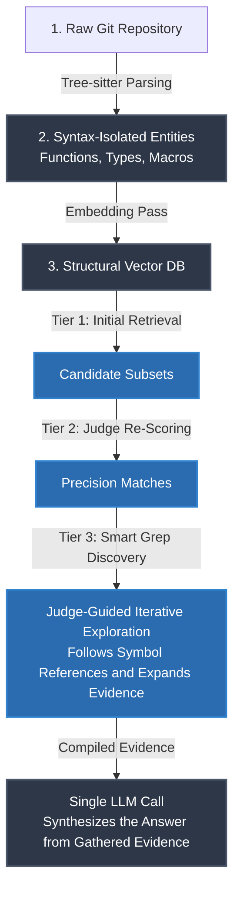

# unified-brain

**Persistent memory for System One coding agents, by [DevLoops](https://devloops.ai).**

On 24/10/2026 I have published as OSS a framework I call unified-brain: evidence gathering that is fast and cheap, and close to a frontier coding agent in accuracy. On the same nine-question, 74-point xz benchmark (`evals/questions/xz.md`) it has four measured profiles (`env.example`). The strongest agent I have measured is Claude Fable 5.2 at max reasoning effort: 72.75 / 74, in 5,372 s, for about $50 (`evals/results/qa-xz-2026-11-13-fable-5-2-agents.md`). Against it:

| Profile | Score | Share of Fable 5.2 max's points | Cost, nine questions | Cheaper by | Time, nine questions | Faster by |
|---|---|---|---|---|---|---|
| **Full** | 70 / 74 | 96 % | $0.660 for six questions ¹ | about 50× ¹ | 435 s for six questions ¹ | 8.6× ¹ |
| **Cheap** | 68.75 / 74 | 94.5 % | $0.253 | about 196× | 519 s | 10.4× |
| **Hybrid-reliable** | 66.5 / 74 | 91.4 % | $0.135 | about 367× | 396 s | 13.6× |
| **Ultra-fast local** | 62.0 / 74 | 85.2 % | $0.161 | about 308× | 90.7 s | 59× |
| Claude Fable 5.2, max effort | 72.75 / 74 | — | about $50 (estimated) | — | 5,372 s | — |

¹ The Full run has complete footers for six of the nine questions (Q1, Q2, Q3, Q7, Q8, Q9). Its cost and time are compared with Fable 5.2 on those same six: about $33.21 and 3,752 s.

How to read the table:

- Fable 5.2's cost is an estimate from the tokens the harness reported, at list prices with prompt caching on ($42 to $57 for the nine; the table uses the middle). It is not a bill, and thinking tokens are not counted, so it is more likely too low than too high. Our costs are measured from the answer footers.
- Full and Cheap were measured on xz at `45d08abc` with the writer on Fireworks; Hybrid-reliable, Ultra-fast local and Fable 5.2 on xz at `7baf6835`, ours with the writer on Isoquant, which is cheaper.
- Ultra-fast local is the Jev-judge run of 2026-11-13; its eval file is not in `evals/results/` yet. The same profile with the pplx judges is (`qa-xz-2026-11-13-ultrafast-local-k40-pplx.md`: 62.25 / 74, $0.065, 12.1 s per answer).
- One run per question for every row, and one grader (Claude Fable) for all of them.

Full also equals a Claude Opus 5.5 agent (70 / 74) and is above a Claude Fable 5.1 agent (69 / 74), both at high effort (`qa-xz-2026-10-29.md`). It started at 86.5% on 29/10; every retrieval change on the way is written up in `evals/results/`. The evaluator is done by a decision judge model (Jev, or the open-weights pplx-decider), not by the writer model that can be anything you want.

The writer is a totally separate phase that works in one go.

The magic sauce is an intermediary OS (SQLITE) memory layer that facilitates retrieval, filtering and judging through a System One decision model — depending the profile, pplx-decider, an open-weights 27B (Apache-2.0), pplx-flash or Jev, a proprietary one, in the coverage profile.

The agent spawned from unified-brain runs through MCP on Cursor, OpenCode or Claude Code etc. allowing you to use it through your favorite harness.

> So to be clear here: unified-brain is not a harness but a perception layer any harness plugs in!

The evals on two large OS libraries (xz and open62541, in `evals/` on this repo) are close enough to the frontier agents, at a fraction of their cost, that I believe this is a missing link to make AI more reliable.

This is because the limits holding back AI are:

- **The Reasoning and Hallucination Gap**:

The LLM turn reasoning it is introducing uncertainty and probabilistic outcomes.

BUT.. Unified-brain's System One discovery engine breaks the task into hundreds of yes-or-no calls, so the search itself does not reason in prose and cannot hallucinate a path. Across five graded xz runs the answers contained one wrong claim per run at most, always the same one on the longest answer — a constant misquoted by the writer with the right value in its evidence; never a retrieval error. Replicability across runs has not been conclusively measured yet.

- **Context Loss and Memory Limits**:

Long-running coding tasks consume massive amounts of tokens, causing the agent to forget early instructions or lose track of large-scale architecture.

BUT.. Unified-brain doesn't need cached memory thanks to the SQLITE persistent layer of context it operates with. It simply retrieves what it needs on the fly: the writer reads 80 k tokens per question on average (2 k to 166 k) against 1.1–2.2 M billed tokens per question for the frontier agents, and nothing builds up across questions. Every question is independent from one another as git diffs and commits will automatically be absorbed from the project's memory layer (still working on that last part).

---

Perhaps the most exciting development however from this proposed shift (established turn based exploration to System One evidence gathering) might be that avoiding unnecessary autoregressive investigation can reduce repeated weight and attention-state memory traffic. By using persistent retrieval and non-autoregressive judgments for discovery, unified-brain has a credible mechanism for reducing energy per correctly answered question — even when the conventional agent uses prompt caching.

**Several architectural factors support this optimism:**

- **Fewer intermediate decoding steps—even with caching.** In a conventional full-attention agent, each generated reasoning or tool-selection token attends to the accumulated context through its KV cache. Caching avoids recomputing earlier token states, but does not eliminate the attention work and memory access needed for subsequent generation. By replacing many intermediate generated tokens with bounded non-autoregressive judgments, unified-brain can avoid those repeated accesses during discovery.

- **Reduced KV-cache pressure.** Keeping investigation state outside the generative model can reduce the intermediate tokens whose attention states must be stored, accessed, or recomputed.

- **Less attention over exploration history.** The writer can receive selected evidence without repeatedly attending to unsuccessful searches, redundant tool results, and earlier investigative discussion.

- **Less repeated prefill work when caching misses.** Separating discovery from synthesis reduces opportunities for growing or changing prompts to trigger redundant computation.

- **Reusable repository preparation.** Persistent symbol and history indexes spread the cost of parsing and organizing evidence across many questions.

- **Efficient execution of independent judgments.** Non-autoregressive decisions can be batched or run concurrently, creating opportunities for better hardware utilization without generating intermediate prose.

- **Reduced demand for frontier-model execution.** Reserving the generative model primarily for synthesis can reduce its total inference workload, potentially lowering the serving capacity needed for a fixed volume of tasks.

- **Potentially greater serving capacity.** Reducing generative investigation could allow existing infrastructure to serve more correctly answered questions per minute by freeing model execution time and KV-cache capacity. The gain depends on the serving bottleneck and the resources required by the judge, retrieval, and final synthesis.

- **Potentially fewer corrective attempts.** If structured discovery improves evidence completeness and accuracy, it can reduce costly follow-up investigation and answer regeneration.

None of the energy savings has been measured. The measured quantities are tokens, dollars and seconds, in `evals/`.

---

I invite you to fork the project and have a look for yourself! I firmly believe that memory intermediate structures combined with System One models will take AI capabilities to the next level soon.

The philosophy behind this venture is to address contemporary inference issues in SWE through architectural elegance, rather than relying primarily on brute force scaling.



The judge is no longer tied to one vendor. On 2026-11-05 I wrote here that there was no parity between Jev and the open models I had tried; a day later pplx-decider (Perplexity's 27B decision model, Apache-2.0 licence with gated weights, $0.02 / M on OpenRouter) is the default judge. It is still a hosted model: the weights need an authorised token and Perplexity's own serving code, so running the judge on your own machine is not yet an option with either model. Measured on the same nine xz questions: Jev 70 / 74 at about 9 cents of judge cost per question ($0.49 for the nine); pplx-decider 68.75 / 74 at about 1 cent per question ($0.09 for the nine) with the cheap settings (`evals/results/qa-xz-2026-11-06-pplx.md`). With Jev's own settings pplx-decider scored 66.5 (`qa-xz-2026-11-05-b-pplx.md`), and another open 27B, Cloudflare Clef, scored lower at six times Jev's cost — so this is one model that works, not open models in general. Jev stays the coverage profile: 1.25 points ahead, for three times the judge cost.

With the fixed 400-call scoring step gone (35–204 judge calls per question now), a judge running on the user's own machine is the next thing to try.

## How it works

unified-brain reads a repository's whole git history and stores every version of
every symbol — functions, types, macros, config entries — with the commit that
introduced it, using tree-sitter, in one SQLite
db inside the repository in question (`<repo>/.unified-brain.db`). On top of that it
answers two questions, as of any commit:

- **Ask** — "why does X do Y?", answered from the bodies that were live at the
  commits you pick, found by embeddings → a decision judge (pplx-decider or
  Jev: a small model that scores bodies and follows names through the code)
  → one write by the LLM of your choice.
- **Timeline / reports** — pick a range of commits and have every changed symbol
  judged: does the change do what the commit message says, or is there a defect
  or a malicious intent behind it? Each verdict comes with the evidence the
  judge was shown (diffs, same-commit changes, callers, the chains it followed).

No LLM is used during ingestion. One embedding pass runs at the end.

## Requirements

- Python 3.11 or newer (SQLite comes with it; nothing else to install or run)
- API keys: [OpenRouter](https://openrouter.ai) (the judge), one embedding provider —
  [Voyage AI](https://www.voyageai.com) or [DeepInfra](https://deepinfra.com)
  (Qwen3-Embedding-8B, cheaper) — and one writer provider ([Fireworks](https://fireworks.ai)
  for DeepSeek, or Anthropic).

## Quick start

Everything below runs in a terminal, from the `unified-brain` folder, with the
virtual environment active. The examples use a clone of
[xz](https://github.com/tukaani-project/xz) at `~/code/xz`; use your own path.

### 1. Install

```bash
git clone https://github.com/DevLoops-ai/unified-brain.git
cd unified-brain
python3 -m venv .venv && source .venv/bin/activate
pip install -r requirements.txt
cp env.example .env
```

Open `.env` and fill in Part 1. The minimum (comments only on their own
lines — python-dotenv reads `KEY=value  # text` as the value `# text`):

```
# the database the service answers about (written by step 2)
DB_PATH=/Users/you/code/xz/.unified-brain.db
# writer: llmbase = DeepSeek V4.1 Flash on Fireworks (the evals' writer),
#         isoquant = the same model's 1017 build on Isoquant with zero data
#         retention (Isoquant-ZDR: required; unmeasured on the evals until
#         a results file says otherwise), or anthropic
LLM_PROVIDER=isoquant
LLM_API_KEY=...
# the judge (pplx-decider by default; typesafe/jev-1.13 for coverage), through OpenRouter
OPENROUTER_API_KEY=...
# code embeddings: qwen (the evals), or voyage (then set VOYAGE_API_KEY instead)
CODE_EMBED_PASS2=qwen
QA_VECTOR_STORE=qwen
DEEPINFRA_API_KEY=...
```

### 2. See what will be indexed

Before ingesting, a few seconds show which files the ingester covers symbol
by symbol, which it stores whole, and which it skips (binary files are not
stored). 

```bash
python ingester.py ~/code/xz scan-coverage
```


### 3. Ingest a repository

The ingester reads the git history and writes one file,
`<repo>/.unified-brain.db`. No LLM is used; it is CPU work plus git. When the
commits are in, the embedding pass runs once over the stored bodies.

A first try — a slice of the history, so you see results in minutes:

```bash
# 1,349 commits of xz, from January 2021 (the threaded decoder work) to July 2024
python next_claude.py ~/code/xz \
  --since f7fa309e1f7178d04c7bedc03b73077639371e97 \
  --max 1349
```

`--since <ref>` starts after a commit or tag; `--max N` stops after N commits.
Progress prints one line per commit and a summary at the end
(`✅ 1349 commit(s) ingested … skills created=… updated=… obsoleted=…`),
then the embedding pass (`🧬 embedding pass [voyage] … 1943/1943`).

The whole history of a repository:

```bash
python next_claude.py ~/code/xz
```

On a laptop this takes a while (open62541: 13,474 commits in 96 minutes on an
M3, then 56 minutes of embedding). On macOS keep the machine awake with
`caffeinate`, in the same terminal:

```bash
caffeinate -i python next_claude.py ~/code/open62541
```

Stopped half-way (Ctrl+C, sleep, crash)? Continue from the last ingested commit:

```bash
python next_claude.py ~/code/xz --resume
```

To start over, delete the `.unified-brain.db` file.

### 4. Embeddings (only if you need to redo them)

The ingest already runs the embedding pass for the provider in
`CODE_EMBED_PASS2`. Two cases need the separate commands:

```bash
# the ingest finished but the embedding pass did not (key missing, network):
python next_claude.py ~/code/xz --embed-only

# add or redo one provider's vectors on an existing database:
python reembed_code_vectors.py --provider voyage --db ~/code/xz/.unified-brain.db
python reembed_code_vectors.py --provider qwen   --db ~/code/xz/.unified-brain.db
```

Both providers can live in the same database; `QA_VECTOR_STORE` picks the one
questions use. Cost to expect: open62541's 277,080 body versions cost about
$1.30 with Qwen on DeepInfra. Add `--dry-run` to count without embedding.


### 5. Start the service

`DB_PATH` in `.env` must point at the database you want to ask about — one
service, one repository. Then:

```bash
python codebase_qa_service.py
```

Open http://127.0.0.1:8000 to ask questions and http://127.0.0.1:8000/timeline
for the commit timeline and reports. The server listens on localhost only.
Each answer ends with a line of numbers: time per phase, judge cost (the footer still labels it "Jev"), writer speed.
Ctrl+C stops it.

To switch repositories, stop the service, change `DB_PATH`, start it again.

### 6. Give it to your coding agent (Cursor, Claude Code, any MCP client)

`unified_brain_mcp.py` is an MCP server with one tool, `retrieve`: the agent
hands over the question, gets back the evidence — every body that answers it,
with file, symbol and line — and writes the answer from it. It talks to the
running service, so step 5 must be running; when the service is stopped the
agent works without it and says so.

Cursor — `.cursor/mcp.json` in the project you are working on (Cursor settings
→ Customize → MCP shows it; use Agent mode):

```json
{"mcpServers": {"unified-brain": {
  "command": "/path/to/unified-brain/.venv/bin/python",
  "args": ["/path/to/unified-brain/unified_brain_mcp.py"],
  "env": {"UNIFIED_BRAIN_URL": "http://127.0.0.1:8000"}}}}
```

Claude Code — the same object in `.mcp.json`. The tool takes 20–60 seconds
(the judge is reading); ask the agent to use unified-brain for the question.

The service also answers plain HTTP for scripts: `POST /api/retrieve`,
`GET /api/grep`, `/api/symbol/{name}`, `/api/body`, `/api/history`,
`/api/commit/{hash}`.

## How it is built

| File | Role |
|---|---|
| `next_claude.py` | the `ingest` command: git history → the database file, then the embedding pass |
| `ingester.py` | reads commits and extracts symbols with tree-sitter (C, C++, Python, TypeScript, JavaScript, shell, CMake, make, YAML; m4, assembly and automake by regex) |
| `defkey_reconciler.py` | keeps the symbol index right as lines move, symbols change or disappear |
| `store.py` | the database: one SQLite file, with the text index for grep and the vector tables |
| `skills_lib.py` | the record layer: skills, bodies per commit, edges, code vectors, grep |
| `reembed_code_vectors.py` | the embedding pass (one set of vectors per stored body version) |
| `codebase_qa_service.py` | the FastAPI service: questions, timeline, reports, evidence |
| `templates.py` | the two pages |
| `unified_brain_mcp.py` | the MCP server for coding agents: one tool, `retrieve` (a thin client of the service) |

## Licence

AGPL-3.0, with a commercial licence available — see `LICENSING.md`.
Contributions need the CLA in `CLA.md`.

Copyright (c) 2026 DevLoops SINGLE MEMBER P.C.